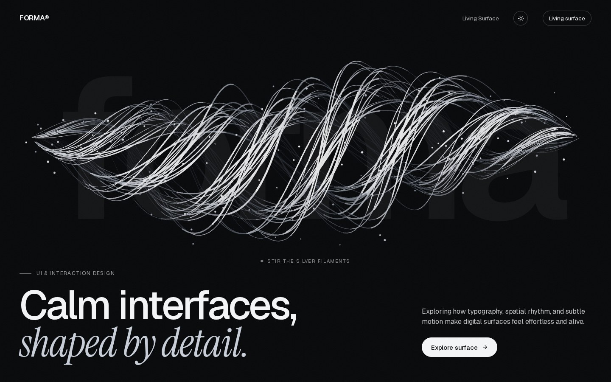
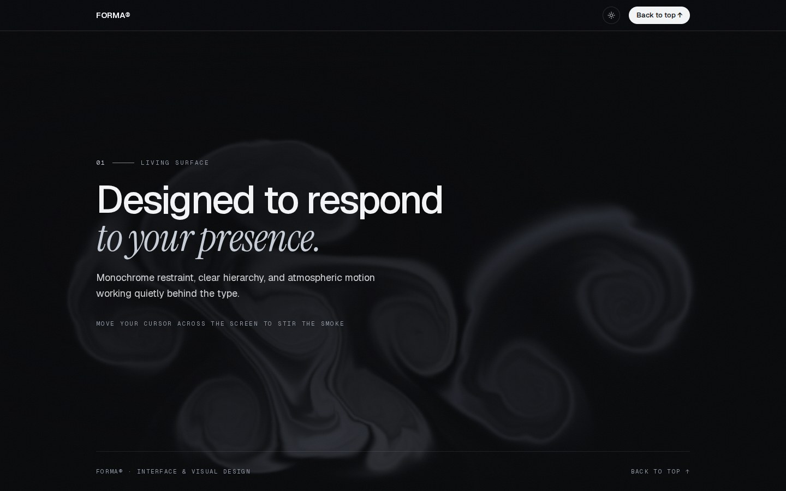

# Liquid Sculpture · FORMA®

An interactive design study in black, white, and silver. Move the pointer across a braided particle sculpture, then scroll to a second scene where it stirs a field of fluid smoke.

[Open Liquid Sculpture](https://liquid-sculpture.vercel.app)





## How it works

The Next.js site renders the sculpture and fluid simulation with WebGL. Both sections share a light and dark theme. A static sculpture is available as a fallback.

## Run locally

Use Node.js 24 and pnpm.

```sh
pnpm install --frozen-lockfile
pnpm dev --port 3001
```

Open [localhost:3001](http://localhost:3001). Use `pnpm build` for a production build.

[Deployment and configuration](docs/DEPLOYMENT.md)
